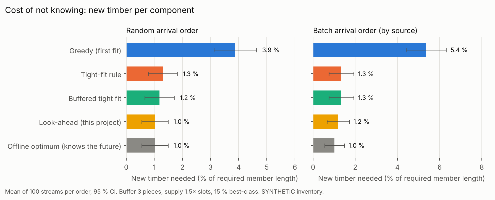
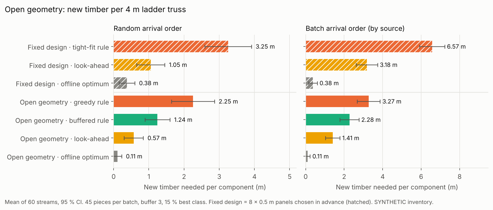

# my_phd_research

Research code for **Building from the Unknown**: robotic fabrication of load-bearing
timber components from an unknown stream of reclaimed pieces, with no inventory and
no fixed design before fabrication.

## Stream simulation (`stream_sim/`)

This is the first experiment. It asks how much it costs to commit pieces before
knowing what material will arrive later, and how much of that cost look-ahead
recovers.

> **Status:** all results so far use a **synthetic inventory**. The structural
> values are **illustrative placeholders**. The numbers show what the method
> does. They are not yet evidence about real reclaimed timber.

### Model (v1)

- **Component:** a statically determinate Pratt truss (span 4.0 m, depth 0.6 m,
  8 panels). Member forces come from the method of joints, solved as one linear
  system and precomputed. A *slot* is one position filled by one piece: chords
  span 2 panels per piece, and verticals and diagonals are one slot each, for
  25 slots in total.
- **Validity:** a piece fits a slot if it is not a reject, is long enough
  (member length + 2 × 50 mm joint allowance), and its tension and compression
  capacity cover the demand. Capacities use a quality class (standard ≈ C16,
  best ≈ C24), k_mod/γ_M = 0.8/1.3, a net-section factor of 0.8, and Rankine
  buckling about the weak axis. These are placeholders to agree with the
  structural engineers.
- **Stream:** a batch of `supply_ratio × 25` pieces is drawn from the inventory
  and arrives one piece at a time, in random order or grouped by source.
- **Decisions:** place the piece in a slot (irreversible; the offcut is waste),
  keep it in a buffer of `B` pieces, or discard it. Discarding a piece that
  still fits an open slot counts its whole length as waste. When the stream
  ends, the pieces in hand are placed optimally, and any slot still open gets
  new timber.
- **Objective:** metres of new timber + 0.05 × metres of waste.

### Strategies

| Strategy | Idea | Knows the future? |
|---|---|---|
| Greedy | First open slot the piece fits (build order) | No |
| Tight-fit rule | Slot with least offcut and least unused capacity | No |
| Buffered tight fit | Keeps pieces; when the buffer is full, places the tightest pair | No |
| **Look-ahead** | When the buffer is full, compares *place p in s* / *discard p* on 16 sampled futures; each future is played out with the tight-fit rule (rollout), then committed one step at a time | Only supply **statistics** |
| Look-ahead (learned supply) | Same, but futures are bootstrapped from pieces seen so far | Only what it has seen |
| Look-ahead (hindsight) | Scores futures by exact assignment, as if they were known (optimistic) | Only supply statistics |
| Offline optimum | Exact assignment of the whole batch (Hungarian algorithm) | Yes, so it's a lower bound |

The simulator only ever shows a policy pieces that have already arrived. A test
checks this by feeding two streams with the same beginning and different endings
and confirming that the decisions on the shared part are identical.

### First results (synthetic inventory)

Defaults: random order, buffer 3, supply 1.5× slots, 15 % best class, 100 streams.
See [`results/summary.md`](results/summary.md) for all tables.

| | Greedy | Tight-fit rule | Buffered tight fit | **Look-ahead** | Offline optimum |
|---|---|---|---|---|---|
| New timber, random order (% of length) | 3.9 | 1.3 | 1.2 | **1.0** | 1.0 |
| New timber, batch order | 5.4 | 1.3 | 1.3 | **1.2** | 1.0 |
| Offcut waste (m per component) | 14.1 | 13.3 | 10.7 | **10.7** | 9.7 |



What this shows so far:

1. **Reacting naively is costly.** Greedy needs 4–5× more new timber than the
   optimum, and more when pieces arrive in batches from one source.
2. **In this simple fixed-truss model, a good rule closes most of the gap.**
   The tight-fit rule recovers about 90 %. Look-ahead recovers the rest, matches
   the offline optimum in almost every setting, and cuts offcut waste by about
   20 % compared with the rule. Its advantage over the rule in new timber is
   small, though: 0.28 ± 0.20 percentage points, better in 7 of 100 streams and
   never worse.
3. **Planning matters most when good pieces are scarce.** At 10 % best class,
   the rule needs 2.5 % new timber and look-ahead 1.75 %, against an optimum of
   1.7 %. See `fig3_scarcity.png`.
4. **A small buffer is enough for look-ahead.** Two pieces reach the optimum in
   this model. See `fig2_buffer.png`.
5. **The scenario evaluator matters.** A first version that scored futures
   optimistically (as if known, with unlimited storage) discarded useful pieces
   and did *worse* than the rule. Playing futures out with a feasible base
   policy (rollout) fixed this.

**Implication for the proposal:** with a *fixed* topology and one piece per
slot, the problem is close to online bipartite matching, and a well-designed
rule is nearly enough. The case for planning ahead has to come from what v1
leaves out. These are the next steps:

- **Emergent geometry:** splice positions along the chords and topology
  variants stay open, so one placement changes which slots exist.
- **Offcut reuse:** one piece can be cut into several members, which turns
  this into online bin packing.
- **Several components from one stream:** using a good piece now costs the
  next component.
- **Build-order and buffer constraints during assembly.**
- **Real MZ/WI inventory data** and agreed structural values.

## v2: open geometry (`stream_sim/ladder.py`)

This version adds open geometry. The **design intent** is fixed in advance: a 4.0 m
span, 0.6 m depth, a line load of 8 kN/m, and panel widths between 0.4 and 0.8 m.
The **geometry** emerges while building: how many panels there are and how wide
each one is. The truss grows from the left support and must close exactly at the
right one, with at most 2 unfinished panels at a time.

When a piece arrives, the options are:
- place it in an open slot
- **open the next panel with a width chosen for this piece**, placing it as that
  panel's chord, diagonal or vertical
- keep it in the buffer
- discard it

Member demands come from a conservative beam analogy (M/h for chords, V·L/h for
diagonals) that doesn't need the final geometry. A test checks that it bounds the
method-of-joints forces on 300 random layouts.

The **offline optimum is exact**: it tries all 14,063 layouts, each with an exact
assignment. A **fixed design** (8 × 0.5 m, chosen in advance) runs on the same
streams for comparison.

Results: synthetic inventory, 45 pieces per batch, buffer 3, 15 % best class,
60 streams. New timber is in metres per component, out of about 22 m of members.

| | Fixed design · rule | Fixed · look-ahead | Open · greedy rule | Open · buffered rule | **Open · look-ahead** | Open · offline optimum |
|---|---|---|---|---|---|---|
| Random order | 3.25 | 1.05 | 2.25 | 1.24 | **0.57** | 0.11 |
| Batch order | 6.57 | 3.18 | 3.27 | 2.28 | **1.41** | 0.11 |



What changes compared with v1:

1. **With open geometry, rules are no longer enough.** Look-ahead needs about
   4× less new timber than the greedy rule. Over the greedy rule, it saves
   1.68 ± 0.48 m (random order) and 1.87 ± 0.43 m (batch order), and it is
   better in 39 and 53 of 60 streams and worse in 1 and 2. It also halves the
   new timber of the buffered rule.
2. **Open geometry beats a fixed design.** The same strategy needs less new
   timber when the panel widths can adapt, especially with batch arrivals:
   6.6 m → 3.3 m for the rule.
3. **The advantage holds under scarcity and different supply volumes.** See
   `fig_ladder_scarcity.png` and `fig_ladder_supply.png`.
4. **A gap to full foreknowledge remains** (0.57 m against 0.11 m). That gap is
   what better supply models, larger buffers or human hints could recover.

Caveats:
- The data is synthetic and the structural values are placeholders.
- The look-ahead uses the greedy rule as its base policy, so improving on that
  rule is expected. The size of the improvement is the finding.
- A cleverer hand-designed geometry rule might close part of the gap. Look-ahead
  needs no such rule for each design family.
- The offline optimum ignores build order and storage, so it is a loose bound.

Run it with `python experiments/run_ladder.py` (~8 min on 2 cores), then
`python experiments/make_ladder_figures.py`. Results go to `results/ladder/`.

### Run it

Requirements: Python ≥ 3.10, numpy, scipy, matplotlib, pandas, and pytest for
the tests.

```bash
python -m pytest                              # 21 tests
python experiments/run_experiments.py         # ~3 min on 2 cores -> results/runs.csv
python experiments/make_figures.py            # figures + results/summary.md
python experiments/run_experiments.py --inventory data/mz_wi.json   # real inventory
```

The JSON loader (`stream_sim.inventory.load_inventory_json`) accepts a list of
pieces with an id, a length (m or mm), a section (`"45x70"` or width/height in
mm), and a quality (`reject`/`standard`/`best` or 0/1/2). Adapt it to the
actual MZ/WI format if needed.

### Layout

```
stream_sim/structure.py   truss, method of joints, slots, capacities
stream_sim/inventory.py   pieces, synthetic inventory, JSON loader, stream orders
stream_sim/model.py       piece-slot validity, exact assignment oracle
stream_sim/policies.py    greedy, rules, look-ahead (rollout / hindsight)
stream_sim/simulator.py   online episode, offline bound
stream_sim/ladder.py      v2: open geometry (emergent panel widths)
experiments/              experiment runner and figures
results/                  CSV, summary, figures (synthetic)
tests/                    unit and integration tests
```
